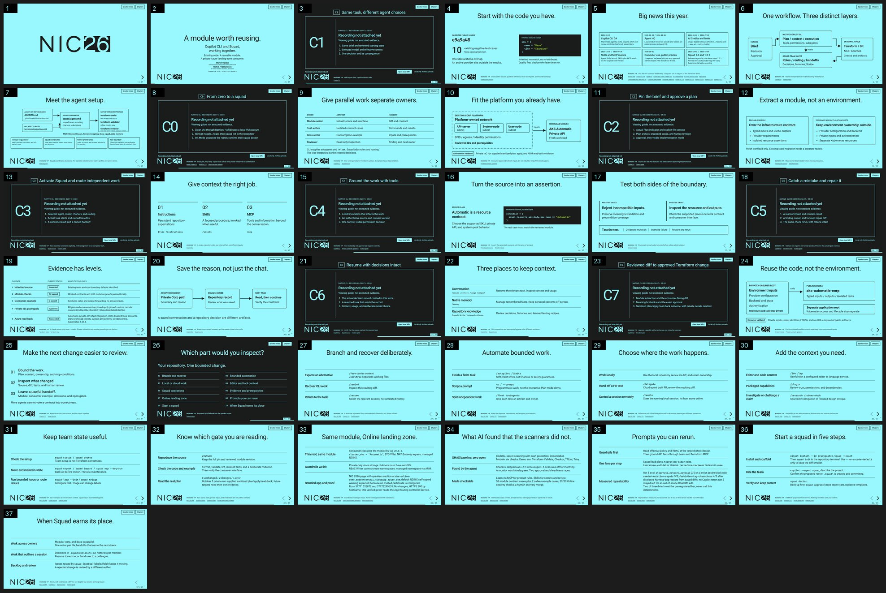

# GitHub Copilot CLI and Squad for Terraform

A two-speaker session by **Martin Opedal, Enterprise Cloud Solution Architect, Microsoft** and **Haflidi Fridthjofsson, Sr Cloud Solution Architect, Microsoft** on using GitHub Copilot CLI and Squad together to build, check, and review Terraform for Azure.

**Planned session:** October 14, 2026, 10:00-11:00, UTC+02:00, Room 6. Exact current NIC listing remains a manual confirmation gate.

**Separate-screen open order:** [short talk track](docs/short-talk-track.md)
(monitor cues) -> [prompt pack](docs/prompt-pack.md) (exact paste) ->
[full talk track](docs/talk-track.md) (narration) ->
[demo runbook](docs/demo-runbook.md) (checks/recovery) ->
[deck](presentation/index.html) (audience).
Double-click the bundled deck to view slides; use [Pages](https://martinopedal.github.io/squad-terraform-session-2026-10-14/presentation/)
or HTTP for reliable `S` speaker view. Viewing doesn't require npm or Python.

Released **deck 0.22.6** synchronizes exported speaker notes with accepted
ACA SANDBOXES engineering, accepted owned-hosted source/runtime holds and VM preservation.
Main/Pages publication completed October 13 after PR22's normal merge and
full/short HTML byte verification. The 39/5 slides, on-screen design/commands
and 55/3/2 timing are preserved. Later local corrections still require independent
review, normal merge and Pages byte verification; a matching version is not proof
that new bytes are published. Publication grants no runtime or human stage GO.
Owner-native source preparation is under review; executable delivery remains
held, with plan/apply/destroy unconditionally disabled and signer/private-plan
transport/executable integration not provisioned. This is not deploy-on-merge.
The current grounded operator-note candidate is **0.22.7**, not yet published;
the released 0.22.6 facts above remain unchanged.

## What this repository contains

Audience: session presenters, public contributors and demo operators. This clone
owns the deck/notes, session setup, generic Corp module copy and native teaching
profiles. **It is not the live environment deployment entry.** Use
[which repo to clone/read/change](docs/repositories.md) for the complete map.

## Source and deployment table

Folders are relative to the named clone, or generic operator-resolved aliases,
not private machine paths. [Canonical table/provenance](docs/source-provenance.md#source-and-deployment-table)
is linked from the runbook.

**Visibility versus placement:** all linked GitHub source repos are public;
real secrets/state/approvals remain private. Online is primary placement for
eligible demo components, not a policy escape/fallback. Corp-required private
workloads stay Corp. Online AKS has a public demo app, while native SandboxGroup
control-plane access remains separately scoped/authenticated and may be private.
Preserve existing working AKS, Corp and hosted Jobs. Do not redeploy or alter
them for checklist completion or automatically repair a working cluster because
of reported TLS/native-API limits. Only a separately approved new native
Online five-object setup and credential-free Ubuntu 1 CPU/2 GiB base probe
were independently verified October 12, including all five exact bindings,
current exact-group data-plane access and an empty list after owned test deletion.
This proves bounded provisioning/basic runtime, not full Copilot/Squad integration
or stage GO. A corrected 26.768-second host run returned three positive guest
checks/JSON+SHA, actual exit23 and HTTPS403 with a new exact-sandbox causal denied
audit, then exact cleanup/empty list/NotFound and watchdog stop. Independent
acceptance is complete; the ACA SANDBOXES engineering contract is DONE and the native card is runtime-ready.
Earlier CRLF failure is learning history, not the current failed lane;
no inside-MicroVM OAuth, credential copying or wider resource authority.

| Component | Canonical repo / source | Local folder | Where to edit | Where / how to deploy | Status |
| --- | --- | --- | --- | --- | --- |
| Session docs, deck, skills/native profiles | [Session repo](https://github.com/martinopedal/squad-terraform-session-2026-10-14) | Session clone `.\` | `docs`, `presentation\src`, `.github\skills`, `.github\agents` | Reviewed PR -> normal `main` merge -> existing Pages release; not Azure deployment | Released 0.22.6 on main/Pages / 39 full / 5 short slides; later local corrections require their own review/release |
| Upstream AKS Automatic module | [Automatic module](https://github.com/martinopedal/terraform-azapi-aks-automatic) | `<automatic-module-clone>` | Canonical module contract/tests | Reviewed module release; consumed by demo-env pin `v0.6.0` | Public reusable source, not environment deployment entry |
| Independent Corp teaching module | [Public Corp module](https://github.com/alz-avm-tf-demo/terraform-azapi-aks-automatic-corp) | `<corp-module-clone>`; session copy `terraform\modules\aks-automatic-corp` | Canonical Corp module, then reviewed mirror/manifest | Private approved Corp consumer, not session clone | Separate unchanged pin/manifest; public source |
| Existing Online AKS / demo VM | [Live demo-env consumer](https://github.com/martinopedal/aks-automatic-demo-env) | Consumer clone `deployments\online` and its demo-VM root | Consumer roots/manifests/runbook | Existing gated consumer workflow, private environment/state and exact approval | App/2 replicas PASS with TLS bypass; canonical 26 PASS/2 BLOCKED/1 report-only, not full health |
| Haflidi hosted Squad ACA Jobs | [Hosted implementation](https://github.com/haflidif/squad-on-aca) | `<hosted-implementation-clone>` | Read the completed authored implementation; **leave it alone** | Existing working protected service; no source/deployment change | Original SQUAD ON ACA APPS/JOBS implemented/previously demonstrated; fresh current E2E proof pending. Separate new personal target/rehearsal is not its implementation status; ACA SANDBOXES success does not qualify this path |
| Owned hosted MIT fork | [martinopedal/squad-on-aca PR1](https://github.com/martinopedal/squad-on-aca/pull/1), credited to @haflidif | `<owned-hosted-fork-clone>` | Accepted app/worker source only; no second infrastructure writer | Existing owner-native Terraform is the sole whole-body writer; standalone fork Bicep is not a second deployment entry | Source accepted at `411bbf1810799bbfeea176e0c4123504a05430e8`; 71 tests/actual Linux UID/publication CI SUCCESS; normal merge `623c1906c1b8cacd13ccd1890d3d77ad3241560`, not live E2E |
| Hosted issues / queue / bot PRs | Intended private target, not implementation source | `<approved-target-clone>` | Only approved target task/PR | One approved issue -> private scheduled poller -> existing queue -> genuine Squad UID10001 worker -> trusted README App-bot PR | Owned fork/target source accepted/merged; private publisher qualification awaits existing human gate. Owner-native Terraform/full QA/plan/image/auth/actual PR pending; no new runner registration/AppAdmin |
| Native ACA SandboxGroup MicroVMs | [Demo-env consumer](https://github.com/martinopedal/aks-automatic-demo-env) native source; [official CLI](https://sandboxes.azure.com/docs/sandboxes/quickstart/setup-cli) | `deployments\aca-sandboxes-online` | Separate Bicep root/sandbox-only protected lane, not AKS/Jobs/Corp | Primary Online; approved one-time Owner bootstrap, independently verified five-object deployment/readbacks; source PR human review remains separate | Provisioning/current operator access/base probe verified October 12; cleanup empty; corrected host runtime PASS / independent acceptance complete; card runtime-ready after acceptance; second-presenter/rehearsal stage GO pending |
| Local Copilot sandbox | [GitHub local sandbox docs](https://docs.github.com/en/copilot/how-tos/cloud-and-local-sandboxes/using-local-sandboxing) | Presenter host working directory | Approved local sandbox policy; repo instructions are guidance only | Native local MXC, **not Azure deployment** | Actual startup exit 1; policy blocked, no bypass/global change |

The presentation shell and speaker material are built and reviewed. The public Terraform module passed local qualification: 52 module cases, two caller cases, two fail-restore-pass mutation evidence checks, hosted Terraform matrix CI, native agent-setup CI, and an IaC-based Azure validation in a private Corp landing-zone consumer. Full human rehearsal remains pending.

The live demo consumer is [martinopedal/aks-automatic-demo-env](https://github.com/martinopedal/aks-automatic-demo-env). It owns the Online/demo-VM roots and gated deployment workflows and pins [martinopedal/terraform-azapi-aks-automatic](https://github.com/martinopedal/terraform-azapi-aks-automatic) by tag `v0.6.0`. The copied Corp teaching module below is a separate source and evidence lineage, not that consumer's module pin.

## This repository and the demo stack

The table above is preserved. This repo supplies **docs, prompts, Squad
coordination and presentation material**, not all private infrastructure.
[Stack overview](docs/stack-overview.md) adds the approved demo-only
resource-group/subscription matrix, owner-root boundaries, capabilities diagram
and actual AKS app ingress. [Module consumption](docs/module-consumption.md)
explains the existing consumer's exact source/pin, typed inputs, root providers/
authentication/backend, outputs and separate human gates. The upstream Automatic
module is a consumed dependency: do not change it for documentation or silently
upgrade it; a verified bug needs separate evidence/owner review.

Read essentials -> walkthrough -> technical detail. Hosted ACA Apps/Jobs and
native ACA Sandboxes are separate optional lanes, last and only if time allows.
The guides add architecture facts, not deployment authority or a new run sheet.

| Path | Content |
| --- | --- |
| [`presentation`](presentation/README.md) | Offline-capable Reveal.js presentation with speaker notes |
| [`docs\repositories.md`](docs/repositories.md) | Public source/copy/consumer map, private deployment boundary and hosted target distinction |
| [`docs\stack-overview.md`](docs/stack-overview.md) | This repo's role, approved demo RG/subscription inventory, owner roots, capabilities and actual AKS ingress |
| [`docs\module-consumption.md`](docs/module-consumption.md) | Existing consumer's exact Automatic module pin, typed wiring, root auth/backend/state, outputs and execution boundaries |
| [`docs\talk-track.md`](docs/talk-track.md) | Timed Martin/Haflidi script, handoffs, and prepared Q&A |
| [`docs\run-plan.md`](docs/run-plan.md) | Countdown, minute-by-minute run sheet, preflight, and fallbacks |
| [`docs\overview.md`](docs/overview.md) | One-page high-level overview of the session flow and why the gates matter |
| [`docs\clean-machine-demo.md`](docs/clean-machine-demo.md) | C0: from-zero Copilot CLI and Squad install on the clean demo VM |
| [`docs\bootstrap.md`](docs/bootstrap.md) | Repeatable Windows core-toolchain bootstrap, zero-auth/dry-run options, optional Docker gates and manual readiness checklist |
| [`docs\sessionize.md`](docs/sessionize.md) | Updated title, abstract, outcomes, pitch, and speaker metadata |
| [`docs\feature-guide.md`](docs/feature-guide.md) | Source-verified Copilot CLI and Squad features and practical use cases |
| [`docs\sandboxing.md`](docs/sandboxing.md) | Four execution hosts, current readiness, and documented-versus-installed availability |
| [`docs\aca-sandboxes.md`](docs/aca-sandboxes.md) | Official quickstart, verified Online base/failed local harness/pending full-work coverage and conditional C4 gates |
| [`docs\prompt-pack.md`](docs/prompt-pack.md) | Rerunnable prompts for building a module like this with Squad, the native lanes, and MCP |
| [`docs\determinism-eval.md`](docs/determinism-eval.md) | Repeatability eval for three bounded Terraform briefs, including misses and oracle rules |
| [`docs\playbook.md`](docs/playbook.md) | Verified step-by-step playbook for bootstrapping Squad, using the native Terraform agents, repeatability prompts, and the demo-env handoff |
| [`docs\online-demo.md`](docs/online-demo.md) | Existing Online AKS consumer through a gated pipeline; historical October 8 29/29 checks, not new native MicroVM readiness |
| `terraform\modules\aks-automatic-corp\` | Public source copy of the independently versioned demo module |

The copied teaching module's separate repository is [terraform-azapi-aks-automatic-corp](https://github.com/alz-avm-tf-demo/terraform-azapi-aks-automatic-corp), pinned here to `b01256eb9b1ea6046b9bb8a403662f724a7b6fa7`. The unchanged [source manifest](terraform/module-source.json) binds the matching presentation copy, not the live demo consumer. See the module's [qualification summary](terraform/modules/aks-automatic-corp/VALIDATION.md) for the exact boundary.

That manifest identifies the published module-copy binding. Azure validation used private consumer code pinned to runtime module commit `02e10e56bc15cc30c3193dce3ddc8e608cb87daf`; this docs-only module revision records the result without publishing private inputs.

The [C0-C7 operator runbook](docs/demo-runbook.md) provides current-shell commands, native prompts, speaker handoffs, and operator checkpoints; C0 runs on the clean demo VM per [clean-machine-demo.md](docs/clean-machine-demo.md). Use it for the later genuine clean demonstration.

## Native agents alongside the existing Squad

[CONTRIBUTING.md](CONTRIBUTING.md) wires the file-backed
[terraform-coder](.github/agents/terraform-coder.agent.md),
[terraform-validator](.github/agents/terraform-validator.agent.md), and
[terraform-reviewer](.github/agents/terraform-reviewer.agent.md) into the
existing [Squad routing](.squad/routing.md). Select them through `/agent` in the
current CLI window; do not reinstall Squad. Root profiles are needed for root
discovery even though the module copy contains the same supporting files.

The coder has `read`, `search`, `edit`, and selected read-only MCP docs tools.
The validator has `read`, `search`, and `execute`, is manual-selection only, and
has no `edit` tool, but its shell can still write files; the command list is
enforced only by its instructions and native approval prompts. The reviewer has
`read`, `search`, and selected read-only MCP docs tools. Squad scopes and receives the
handoff; the human maintainer owns acceptance. Native permission prompts and
separate publication/private-consumer apply gates remain in place.

Coder and reviewer ground claims through Microsoft Learn and Terraform Registry
MCP servers. MCP policy is hosted first: Microsoft Learn is cloud-hosted. The demo uses a
Docker-run Terraform MCP server pinned for this session; HashiCorp documents
local deployment (including Docker) and self-hosted transports. Docker Desktop and network access are required for
Learn/registry docs. Copilot CLI and Copilot cloud agent honor `mcp-servers`; VS
Code ignores that frontmatter. MCP results are documentation lookups, not
validation or Azure acceptance. The native Terraform MCP binary is not used for
this demo.

The [qualification skill](.github/skills/qualify-agent-setup/SKILL.md) provides
executable static and negative checks using existing Node.js and Git:

```powershell
node .github\skills\qualify-agent-setup\check.mjs
node --test .github\skills\qualify-agent-setup\check.test.mjs
```

These checks provide evidence for setup integrity, not a genuine native agent run, MCP server
startup, independent review, or Azure acceptance. See the contributing guide for
full module-copy comparison.

## Open the presentation

[](https://martinopedal.github.io/squad-terraform-session-2026-10-14/presentation/)

The built [Reveal presentation](presentation/index.html) ([slide-by-slide preview](presentation/README.md#preview)) reports 39 slides total. Its 60-minute live-first contract uses a 3-minute intro, 52 minutes of planned content before recovery, a visible 3-minute protected recovery window, and a 2-minute close. The 29 live demo minutes for C0-C7 sit inside that planned content. Questions happen only if time allows. See [docs/run-plan.md](docs/run-plan.md) for the full minute-by-minute schedule.

A six-slide companion cut is built at [presentation/short/index.html](presentation/short/index.html).

For speaker notes, serve the clone locally:

```powershell
python -m http.server 4173 --bind 127.0.0.1
```

Open `http://127.0.0.1:4173/presentation/` and press `S` for speaker view or `N` for named chapter navigation. The deck is live-first and ships without attached chapter media. No custom file-viewer material is presented as Copilot CLI or Squad.

## Public code, separate deployment configuration

The module and its generic examples are public. The user-approved nonsecret
demo-stack RG names and four subscription IDs are documented only in the
[bounded stack matrix](docs/stack-overview.md#resource-group-and-subscription-matrix)
and directly related explanation. Other real identifiers, environment inputs,
credentials, private policy evidence and Terraform state remain outside this
repository; the matrix grants no resource-creation or deployment authority.

The reusable public module is [`martinopedal/terraform-azapi-aks-automatic`](https://github.com/martinopedal/terraform-azapi-aks-automatic). Demo-environment roots, manifests, operational scripts, and gated deployment workflows now live in [`martinopedal/aks-automatic-demo-env`](https://github.com/martinopedal/aks-automatic-demo-env), which pins the module by tag `v0.6.0`.

The demonstration reuses an existing Azure Landing Zones Corp environment. The public module consumes approved platform resources; it does not deploy a new landing zone or import existing estate resources. The October 5 validation ran through a private platform pull-request workflow and publishes only sanitized results.

## Evidence boundary

The starting AKS root configuration has known validation and documentation issues. It is not a verified deployable module. The project records the actual implementation and repair work, then keeps code checks, Azure deployment evidence, and presentation evidence separate.

Format, lint, and mocked tests remain separate from Azure service acceptance. The October 5 private validation supplied one approved Corp target, reviewed PR plan/apply, and ARM read-back; later environments still require their own plan, policy, identity, DNS, routing, and cleanup evidence.

The user approved code-first qualification followed by a genuine clean run from a disclosed checkpoint. Earlier work will not be relabeled as later live evidence.

The current build claims only the public deck and the sanitized private IaC validation summarized above. Read [QUALITY.md](QUALITY.md) and [PUBLICATION.md](PUBLICATION.md) for the evidence and release boundaries.

## October 12 status: separate lanes, not all ready

- **Existing Online AKS:** earlier Online/Corp metadata Succeeded/Running. Fresh reviewer app/source-matching assets and two responding replicas PASS with explicit TLS bypass; canonical 26 PASS / 2 BLOCKED / 1 report-only, not 29/29. Corrected supplemental scoring: 10 PASS / 1 FAIL (untrusted/mismatched TLS) / 1 NOT_APPLICABLE (external `/healthz`; source contract requires direct-pod `/healthz` 200 `ok`, not that external route). Native Kubernetes access unavailable/ResourceHealth unregistered; full cluster health unproved. Eleven policy-noncompliant resources are within the demo RG across AKS/network/state, not 11 cluster failures or subscription-wide findings. C1 Oct 13 remains scheduled.
- **Native ACA SandboxGroup MicroVMs:** separate primary Online five-object deployment Succeeded and all five exact bindings were independently verified October 12. Current operator exact-group data-plane access passed; the credential-free base probe covered exec/public filesystem/stop-resume/deletion, with an empty final list. Deny/Full configuration is not complete attributable egress enforcement. Corrected 26.768-second host runtime returned three guest checks/JSON+SHA, actual exit23 and causal HTTPS-denial/cleanup evidence; independent acceptance is complete and the native card is runtime-ready. Second presenter/manual rehearsal still gate stage GO. Optional inside-MicroVM agents/OAuth are unproved. Held Corp 8-present/3-absent/no-apply qualification remains separate history; leave Corp/AKS/hosted Jobs untouched.
- **Haflidi hosted Squad ACA Jobs:** original [haflidif/squad-on-aca](https://github.com/haflidif/squad-on-aca) implementation remains working/previously demonstrated; **leave original source/deployment alone**. The owned MIT fork, private target handoff and private publisher source are accepted/merged, not live E2E. Current holds are actual publisher Docker/DNS/TLS qualification at its existing human gate, owner-native Terraform source/full QA/plan, immutable image, authentication and genuine README bot PR; no new runner registration or AppAdmin. The old zero-step queued run remains untouched, not proof/cancelled. Native success is not hosted success.
- **Presenter VM:** [consumer PR21](https://github.com/martinopedal/aks-automatic-demo-env/pull/21) is source-accepted, REVIEW_REQUIRED with Haflidi/Online human gates unchanged. VM is deallocated and current OS-disk attachment differs from the earlier receipt: preserve both disks, never swap back/recreate/delete either. Refresh current binding/baseline and runnable SYSTEM context before plan/apply; no machine installation or VM/disk/CSE/power change. Sparse metrics do not prove CPU/RAM bottleneck or sustained causality.
- **Local Copilot sandbox:** actual Windows MXC startup failed before the command, exit 1, on proxy/masking/auth loopback/private-network requirements. Policy blocked; no bypass/global change. One laptop's 18/18 preflight is not a runtime pass.

Optional GitHub-managed `--cloud --experimental --help` parsed with exit 0, not
account entitlement, billing or a launched runtime. Host ACA 1.0.0-preview.4 auth
status passed token checks only. Actual doctor 9/9 exit 0 resolved to cached
Management rather than the explicit target: compare printed target fields and
independent exact-ID read-back, not only the green count. No config change or
Management fallback is authorized.

Use [the owner/date/proof/blocker/next-action matrix](docs/sandboxing.md#october-12-progress-and-next-actions)
and [full MicroVM coverage checklist](docs/aca-sandboxes.md#full-test-coverage-checklist),
grounded in the [official quickstart](https://sandboxes.azure.com/docs/sandboxes/quickstart/setup-cli).
Second-host interactive checks, clean-VM/manual login, 60-minute rehearsal,
invitation acceptance/current read-back and exact NIC listing remain pending.
The earlier USD 20 figure is historical planning/alert context, not current
execution authority; scoped cost consent remains private and retained costs remain.
MCP minreplicas 1 is scheduled October 13/revert October 14, teardown October 17
and credential expiry October 31, not completed.

2026-10-13 pre-publication source freeze: the accepted status revision and deck
**0.22.5** had been released through public PR21
on main/Pages at `fa11ccfd6a3e3e12827c0c94bd1f9b4300f5e68c`.

Current notes/status release: released deck 0.22.6 on main/Pages followed PR22's
normal merge October 13, successful Pages and full/short HTTP 200 byte verification
against the initially accepted exports. Later local correction bytes remain
unpublished pending independent review, normal merge and Pages byte verification.
The directly coupled notes/status fix retains 0.22.6 with no redesign/new
sections/media; a local build or matching version does not publish the correction
bytes. Publication is not runtime or human stage GO.

The [two product demo flows](docs/demo-runbook.md#two-product-demo-flows-hosted-squad-and-native-aca-sandboxes)
are Haflidi's hosted Squad agent work to bot PR, and host Copilot CLI/Squad +
ACA skill driving isolated MicroVM work with actual prompt/tool/validation/
handoff evidence. The VM is presenter-host detail, not a product flow. Standalone
`aca` hello/lifecycle checks are prerequisites, not integration. CLI/Squad
**inside** the MicroVM is advanced optional with separate auth/runtime proof,
not a basic host-orchestration requirement. Native fixture engineering is accepted;
human/selected-Terraform stage GO remains pending.
Fresh validation established app/replica behavior under TLS bypass, not full
cluster health, renewed 29/29 or trusted TLS. Current qualified counts/limits
are above; historical October 8 29/29 stays dated.
