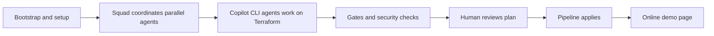

# Overview: the session in five steps

For the minute-by-minute script, see [`docs\talk-track.md`](talk-track.md) and [`docs\run-plan.md`](run-plan.md). This page is the short topic map for colleagues who already know the products.

The session is about using GitHub Copilot CLI and Squad to make Terraform work easier to review. The risk is that AI can produce different answers from the same starting point. The answer is not blind trust. The answer is a clear flow, small roles, grounded source lookups, and the same gates a human change would face.

The live demo consumer is [`martinopedal/aks-automatic-demo-env`](https://github.com/martinopedal/aks-automatic-demo-env), pinning [`martinopedal/terraform-azapi-aks-automatic`](https://github.com/martinopedal/terraform-azapi-aks-automatic) at `v0.6.0`. This session's copied Corp teaching module preserves a separate source-copy pin and manifest; it is not the consumer's module binding.

Use [the complete repo map](repositories.md). The independent
`alz-avm-tf-demo/terraform-azapi-aks-automatic-corp` module is public. This session
clone owns deck/notes/setup and teaching profiles, not live deployment. Haflidi's
public `haflidif/squad-on-aca` is hosted implementation source; the private
issue/queue/bot-PR target is not source or runnable from this clone alone.

1. Bootstrap on a clean VM, then move to the presenter setup.

   Haflidi drives C0 on the clean Windows 11 demo VM. He shows install, login, `copilot`, `squad init`, and the basic getting-started path. Martin adds the boundary that setup is useful, but it is not Terraform correctness. After C0, the session continues in the prepared presenter flow.

2. Show the working model in Copilot CLI and Squad.

   Martin covers the CLI surface, the three Terraform lanes, and the handoff into the repo guidance. Haflidi explains Squad as the coordination layer with routing, handoffs, decisions, and one owner per shared surface. This is where the audience sees how the team is organized before any deeper Terraform point.

3. Start from a finished, qualified module and explain why the gates matter.

   Martin introduces the inherited public module revision and the consumer view. Haflidi explains the module boundary, caller-owned provider and state, and the fact that local checks and Azure runtime evidence answer different questions. The security story sits here: pull requests, protected `main`, required review, environment approval, OIDC, runtime checks, and GHAS controls such as CodeQL, secret scanning, and Dependabot. The determinism point also sits here. C1 and the eval show why the brief must be precise. The logged eval result is B1v2 5/5, B2 5/5, and B3 4/5.

4. Show the framework pieces that make the flow work.

   Martin shows agents, skills, MCP source lookups, and permissions. Haflidi explains the difference between instructions, skills, and MCP, plus the reviewer and validator boundaries. The current docs ground this with Microsoft Learn MCP and the pinned Terraform MCP setup used in the demo.

5. End with the Azure output and the optional extra.

   Martin shows the existing Online consumer page, `AKS Automatic | NIC 2026 demo`. App/assets/two replicas PASS under TLS bypass; canonical 26 PASS/2 BLOCKED/1 report-only, corrected supplemental 10 PASS/1 FAIL (TLS)/1 NOT_APPLICABLE (external `/healthz`; source requires direct-pod 200 `ok`). Native Kubernetes/ResourceHealth unavailable, full health/trusted TLS unproved, not renewed 29/29. Eleven noncompliant resources in demo RG across AKS/network/state, not 11 cluster failures/subscription-wide. Hosted remains optional 53:00-54:30 only if ahead/newly qualified; fresh queue-driven readiness is not established.

Squad is coordination/configuration over the hosting Copilot session, not a sandbox product. [Four hosts](sandboxing.md) separates local OS/MXC `/sandbox`, GitHub-managed Copilot cloud preview built on ACA, customer-managed ACA MicroVMs via `aca`, and hosted Squad Apps/Jobs. A worktree/tool filter does not isolate credentials. October 12 one-laptop read-only preflight passed 18/18, but Corp MicroVM recovery failed and no full CLI+Squad execution inside a MicroVM is established. [Readiness gates](run-plan.md#october-12-readiness-evidence) retain clean VM/manual sign-in, both presenters, full rehearsal, invitation, current NIC listing and teardown as outstanding.

## Two product demo flows: hosted Squad and native ACA isolation

The products define the flows; VM/host location is only a **control-console**
detail, not the runtime for both demos:

Online is primary placement for eligible demos, not fallback/policy escape.
Corp-required private workloads stay Corp; repo visibility does not define
network exposure. Preserve existing working AKS/Corp/hosted Jobs; report
limitations, no checklist redeploy/automatic cluster repair.

- **Hosted Squad on ACA:** Haflidi's original implementation is completed/previously demonstrated; leave it alone. Its **SQUAD ON ACA APPS/JOBS** flow is issue -> Job/agent -> bot PR; fresh current E2E qualification is pending independently of ACA SANDBOXES. Our new personal target/access/registration/rehearsal remains pending (fresh issue open/queue queued/no PR at 10:28 UTC), not evidence original implementation is broken and not a native Sandbox prerequisite. Ask for a fresh new-target rehearsal result only if selected; no new personal technical confirmation is inferred.
- **Native ACA Sandboxes with host Copilot CLI/Squad:** coordinate public isolated work, invoke the ACA skill, inspect actual tools and return guest output/numeric exits/hash in a validator/reviewer handoff. Separate Online five-object provisioning/current operator access/base exec/fs/stop-resume/delete independently verified; cleanup empty. Corrected ACA SANDBOXES 26.768s receipt passes LF/hash/three guest checks/JSON+SHA/exit23/causal denial/exact cleanup; independent acceptance complete, runtime-ready after acceptance, human stage GO separate. Earlier CRLF is learning history; use [the bounded prompt](prompt-pack.md#native-host-squad-isolated-work) only after preparation/approval. Corp held/no-apply history stays separate; no AKS/hosted Jobs dependency. Inside-MicroVM agents/OAuth remain optional and unproved.

See [the two product operator cards](demo-runbook.md#two-product-demo-flows-hosted-squad-and-native-aca-sandboxes)
for folder, owner, login, preflight, trigger, expected evidence, timing/cut,
fallback and owned cleanup. [Full native coverage](aca-sandboxes.md#full-test-coverage-checklist)
is pre-stage, not squeezed into C4. Existing Online AKS, native MicroVMs, hosted
Jobs and local Copilot sandbox are four independent demo lanes. Local MXC
startup failed before command, exit 1; cloud help parse exit 0 is not optional
cloud account/runtime proof. Earlier USD 20 is historical planning/alert context,
not current execution authority; scoped cost consent remains private.

