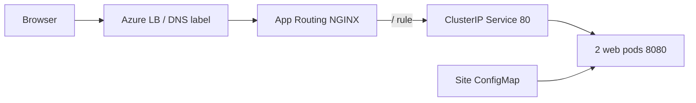

# Short talk track - monitor cues and commands
**Order:** essentials -> C0-C7 walkthrough -> technical evidence -> core wrap -> optional cloud tail.
**Clock:** 55 main / 3 protected recovery / 2 close. Cuts win; one attempt, then dated fallback.
**Stage context:** PowerShell 7 **on the VM**, using agreed `C:\demo\session-repo`
and `C:\demo\aks-automatic-demo-env`. These intended paths are **unverified
on the VM** until [off-stage setup](demo-runbook.md#create-and-verify-the-agreed-vm-layout)
creates/checks them and the disposable checkpoints/mirror.

**WORKSTATION PREPARATION ONLY:** Existing local paths verified October 13, 2026
on the workstation, **not the separately qualified C0 clean VM**:

| Existing local path | Source / boundary |
| --- | --- |
| `C:\git\squad-terraform-session-2026-10-14\public` | `martinopedal/squad-terraform-session-2026-10-14`: session deck and copied Corp teaching module/C1-C7; not a live deployment root. |
| `C:\git\squad-terraform-session-2026-10-14\demo-env` | `martinopedal/aks-automatic-demo-env`: live consumer source, including public ingress manifests; source navigation is not deployment consent. |
| `C:\git\squad-terraform-session-2026-10-14\module-public` | `alz-avm-tf-demo/terraform-azapi-aks-automatic-corp`: canonical Corp module, read-only for this walkthrough; not the upstream Automatic module. |
| `C:\git\squad-terraform-session-2026-10-14\aca-sandboxes` | Session checkpoint directory under the session repository, not an independent native consumer clone or a private target. Native consumer source belongs in `demo-env\deployments\aca-sandboxes-online`. |

These paths establish existing directories/source ownership, not clean checkpoints, runtime access or rehearsal GO. The upstream Automatic module is `martinopedal/terraform-azapi-aks-automatic`; C0 creates its new clone on the clean host below. [Repository ownership](repositories.md).
`!` = whole shell block, same CLI window; variables do not survive turns. Slash actions = TUI; other text = human prompt; no private root/evidence.
No secrets/state, blanket approval, provider/lock upgrades, live plan/apply/import/state removal.
**Before stage:** HUMAN completes only missing session/operation sign-in
[once, before Plan](demo-runbook.md#conditional-human-setup-before-plan).
Source/mocked C1-C7 need no Azure login. Optional GitHub MCP is read/context
only here; working `gh` stays. Open [prompt pack](prompt-pack.md) for exact
paste and [runbook](demo-runbook.md) for full checks, not extra narration.

## Essentials | Martin says: artifact • owner • reason • evidence • human stop
**WHERE:** VM `C:\demo\session-repo`, after setup verification; read-only orientation, not a write checkpoint.
**TYPE:** shell:
```powershell
Set-Location 'C:\demo\session-repo'
git rev-parse --show-toplevel
git log -1 --oneline
git status --short
git --version; copilot --version; squad --version
copilot --agent squad
```
TUI: `/cwd`, `/agent`, `/model` → `claude-sonnet-5`, `/instructions`, `/permissions`.
Small read-only brief, `/agent terraform-reviewer`: `Explain module versus caller ownership and the private API invariant in five bullets. No edits, commands or Azure access.`
**SHOW:** `/cwd`, instructions, three project profiles and permissions.
**EXPECT:** five sourced bullets on module/caller/private API; no edits.
**STOP:** wrong root/missing profiles = exit/restart, not reinstall Squad 1.0.1.
## C0 | Haflidi 05:30-08:30, CUT 07:45 | install • init • hire • verify
**WHERE:** separately qualified clean host; current VM/Haflidi/disk/SYSTEM gates stay.
**TYPE:** [complete install/PATH block](clean-machine-demo.md#the-live-chapter-target-300),
then HUMAN TUI `/login`, `/exit`. This creates a **new** upstream Automatic clone
at `$HOME\demo\aks-module`, not an existing preparation-machine path:
```powershell
git clone https://github.com/martinopedal/terraform-azapi-aks-automatic.git $HOME\demo\aks-module
Set-Location $HOME\demo\aks-module
squad init
git status --short
copilot --agent squad
```
Prompt: `We maintain a reusable Terraform module for AKS Automatic on azapi that deploys into an existing Azure landing zone. Work is Terraform module code, terraform test contract tests, and consumer documentation. Propose a small team.`
Human confirms roster; TUI `/exit`; shell `squad doctor`.
**SHOW:** versions, created team files, roster confirmation and doctor.
**EXPECT:** real install/init/hire/diagnostics, not code correctness.
**STOP:** unqualified host or 07:45 stall = disclose fallback; no VM repair.
## C1 | Martin drives / Haflidi compares 12:30-15:30, CUT 14:45 | fixed inputs
**WHERE:** new public checkpoints
`C:\demo\checkpoints\take-20261014\A`
and `\B`, not the C0 upstream clone.
**SETUP, paths not yet verified on VM:** the
[runbook creation block](demo-runbook.md#create-the-disposable-c1-c7-checkpoints)
must create/qualify these paths first: same starting commit and clean status,
no private histories. The existing `public` clone isn't either checkpoint.
**TYPE:** [A/B shell entry + exact prompt](prompt-pack.md#c1---martin-drives-haflidi-compares-1230-1530-cut-1445);
TUI `/new`, `/agent` → Squad, `/model`, `/plan`, `/rename C1-A`; repeat `C1-B`.
```text
Plan only: add alternate_network_payload to the existing module contract tests. Use pod 172.21.0.0/16, service 10.241.0.0/16, and DNS 10.241.0.10.
Assert propagation into the requested body while preserving the private API. Don't edit files or deploy. Identify affected files, one writer, and checks.
```
**SHOW:** one difference/consequence, not verbosity.
**EXPECT:** same model/checkpoint; identical outcomes are valid.
**STOP:** missing qualified paths or 14:45 = dated fallback; no prose-fishing retry.
## C2 | Martin 17:30-21:30, CUT 20:30 | plan • revise • code-only approval
**WHERE:** VM `C:\demo\checkpoints\take-20261014\guided`, for C2-C7.
**SETUP, guided path not yet verified on VM:** create/qualify it with
the same runbook block; disclose starting commit/status. Never substitute
`public` or canonical `module-public`. Confirm `/cwd` and the shell's actual
directory before each whole `!` block; qualify `..\offline\terraform.tfrc` first.
**TYPE:** guided shell entry in prompt pack; TUI `/new`, `/rename guided-clean-run`,
`/agent` → Squad, `/instructions`, `/plan`.
```text
@terraform\modules\aks-automatic-corp\main.tf @terraform\modules\aks-automatic-corp\variables.tf @terraform\modules\aks-automatic-corp\tests\contract.tftest.hcl
This is prepared, qualified code. Plan the C1 regression test and its README explanation. Keep all eight inputs, six outputs, and the AzAPI resource intact.
Plan a separately labeled enablePrivateCluster mutation and repair. No implementation, Azure lookup, apply, dependency upgrade, or state operation.
```
Revise: `Put unchanged payload assertions and offline checks before documentation; exclude infrastructure redesign.`
**SHOW:** `/session plan`, genuine revision, human exact code-only approval; leave Plan mode via UI.
**EXPECT:** one test writer, four payload/private API assertions; no implementation yet.
**STOP:** missing checkpoint/mirror, unapproved scope, or 20:30 = fallback. Not deployment consent.
## C3 | Martin 22:00-26:00, CUT 25:00 | genuine Squad • one writer • handoff
**WHERE:** same guided CLI.
**TYPE:** TUI `/agent squad`, `/tasks`, `/agent list`, `/mcp`; prompt: `Squad: assign independent read-only source research and review preparation. One coder owns the test; return actual task handoffs.`
Then `/agent terraform-coder`; paste B1v2:
```text
Work only in terraform\modules\aks-automatic-corp.
Add one run block named alternate_network_payload to tests\contract.tftest.hcl. Reuse the existing AzAPI mock and command = plan. Use pod CIDR 172.21.0.0/16, service CIDR 10.241.0.0/16 and DNS service IP 10.241.0.10. Write four separate assert blocks, one each: the pod CIDR, the service CIDR and the DNS service IP propagate into the requested cluster body, and the API server stays private. Each assert gets its own error_message. Change only tests\contract.tftest.hcl. Don't deploy, don't change providers or the lock file.
```
**SHOW:** real task starts/diff/handoffs; manual selection alone isn't parallel work.
**EXPECT:** only `tests\contract.tftest.hcl` changed, four separate asserts/error messages.
**STOP:** concurrent writers, missing actual handoffs, or 25:00. B1v2 5/5 is historical.
## C4 | Martin 29:30-33:30, CUT 32:30 | BASE ONLY • skill • source • permission
**WHERE:** same guided host, BASE ONLY, not either ACA demo.
**TYPE:** TUI `/agent squad`, `/skills info test-discipline`, `/mcp`; prompt:
```text
Invoke test-discipline now. Identify which existing contract assertions must remain unchanged during the mutation.
Through Microsoft Learn MCP, read-only search/fetch AKS Automatic private/custom network requirements; cite source/version for private API and hosted-system subnets. No Azure account or provider changes.
```
**SHOW:** actual skill invocation, source URL/version and `/permissions` narrow read-only request.
**EXPECT:** unchanged assertions and sourced private/custom-network constraints.
**STOP:** missing skill/server, failed lookup, or 32:30. Failed stays failed; no cloud extra.
## C5 | Haflidi 33:30-38:30, CUT 37:15 | before • deliberate fail • narrow repair
**WHERE:** same guided CLI; isolated credential-free Terraform subprocess/mirror.
**TYPE:** `/agent terraform-validator`; `!` paste the **whole**
[C5 logging block](demo-runbook.md#c5-seed-fail-repair--3330-3830--5-minutes)
from prompt pack, first `before`, then `seeded-failure`, then `repaired`.
Approve each command; preserve source hash. Coder alone changes
`body.properties.apiServerAccessProfile.enablePrivateCluster` true -> false,
then restores that one field. `/review` is read-only built-in mutation review.
**SHOW:** DELIBERATE LAB MUTATION, exact assertion failure, `/diff`, numeric exits/hash.
**EXPECT:** pass -> intended `private_automatic_contract` failure -> pass/original hash.
**STOP:** before fails, wrong failure, unavailable isolation, or 37:15 = saved logs.
[Why every check exists](demo-runbook.md#what-the-offline-powershell-checks-do);
don't split environment variables across turns or omit exit guards.
## C6 | Haflidi 42:00-45:00, CUT 44:15 | public reason • resume • cite
**WHERE:** same guided CLI; public decision only.
**TYPE:** `/agent squad`; prompt: ``
TUI `/new`, `/resume guided-clean-run`, `/cwd`, `/context`, `/usage`.
Prompt: `Read the saved decision; cite its file and the constraints for the next change.`
**SHOW:** saved public file, resumed session and cited reason; hide unrelated sessions.
**EXPECT:** next task cites private API/caller/check constraints.
**STOP:** missing resume/citation or 44:15 = saved decision, not fabricated recovery.
## C7 | Haflidi 47:00-50:00, CUT 49:15 | fixed offline checks • independent review
**WHERE:** same guided isolated subprocess; TFLint 0.64.0 already qualified.
**TYPE:** `/agent terraform-validator`; `!` paste the **whole**
[C7 logging block](demo-runbook.md#c7-validate-the-consumer-and-review--4700-5000--3-minutes)
from prompt pack. It defines `Check` locally and stops at the first failure.
`/diff`; `/new`, `/agent terraform-reviewer`. Prompt: `Review this exact diff/revision/files and sanitized validator evidence. Report severity/file/line/consequence; missing evidence is blocked. No edits or commands.`
**SHOW:** fmt/init/validate/lint/module+caller tests, logs/exits, exact diff and independent findings.
**EXPECT:** all clean exits `0`, actual fresh-context review, `/agent squad` + human acceptance.
**STOP:** missing/wrong tools, failed clean check, unrelated diff or 49:15 = reviewed fallback.
Mocks aren't Azure proof; source-only checks need no Azure login.
## Technical evidence / core wrap | Martin + Haflidi, finish by 55:00
**WHERE:** VM consumer root; browser public app. **TYPE:** shell block below,
then 50:30-51:00 browser `https://aks-online-demo.swedencentral.cloudapp.azure.com/`
(known certificate warning).
Say: module/caller • typed inputs • Automatic/Standard • private API • pins/root state • PR/checks/review/plan/human gate/OIDC/read-back.
Current app/TLS-bypassed evidence is not full health or fresh 29/29. No live Terraform apply blob.
Ingress keywords: Azure DNS label/LB -> dedicated managed NGINX -> `/` rule -> Service 80 -> two web pods 8080.
Site ConfigMap mounts page/config; namespace policy admits App Routing traffic. HTTP redirects; default self-signed TLS, no trusted cert/AGC/ALB.
Source-only screen cue, pre-staged PUBLIC consumer clone; no login/kubeconfig/secret queries:
```powershell
Set-Location 'C:\demo\aks-automatic-demo-env'
Get-Content .\manifests\online\ingress-controller.yaml, .\manifests\online\ingress.yaml, .\manifests\online\service.yaml
```
**SHOW:** exact manifests/page. **EXPECT:** source route and branded app, not
renewed cluster health/trusted TLS. **STOP:** unavailable app = dated screenshot,
no repair; core wrap by 55:00. [Source trace](talk-track.md#s20-consumer--5000-5300--an-online-consumer).

53:00-55:00 limits/core wrap first; protect 55:00-58:00 recovery and 58:00-60:00 close. Questions only if time allows.
## Optional final extras - only if time and live gates permit
**DEAD LAST:** only genuine early finish after ALL core work/wrap; never compress core; protect 55:00-58:00 recovery / 58:00-60:00 close.
**1. Squad on ACA Apps/Jobs - Haflidi; currently HELD, read-only or SKIP.** Original service untouched.
**WHERE:** VM `C:\demo\hosted-target`, approved private target;
intended optional `C:\demo\hosted-target` is not verified.
1. **Haflidi, GitHub Issues:** SHOW existing approved README task; EXPECT correct body/no prior attempt; otherwise STOP.
2. **Operator, VM PowerShell:** [whole Card A block](demo-runbook.md#card-a-haflidi-hosted-squad-on-aca-issue-to-bot-pr), `gh issue edit` with `squad:ripley` once; EXPECT label, no new issue.
3. **Operator, hosted poller:** WAIT five-minute schedule; SHOW same-issue queue receipt; EXPECT automatic enqueue, not `gh workflow run`.
4. **Operator, Azure portal:** Container App Jobs -> `caj-squad-aca-agent-corp-ne` -> Executions; SHOW matching actual worker/result. Missing correlation = STOP.
5. **Haflidi, GitHub PR:** linked same-issue bot PR -> Files changed -> `README.md`; SHOW real diff/checks, EXPECT human review, not merge.
**STOP:** held image/auth/chain, prior attempt, missing approved binding, no time = SKIP.
No new issue, retry, unsafe Job start, auth mint, merge, or original-service rebuild.
**2. ACA Sandboxes - Martin; own human GO or SKIP.** Host Squad/controller, native MicroVM, not Apps/Jobs or guest OAuth.
**WHERE:** VM `C:\demo\session-repo`; separate Online
`rg-aca-sandboxes-online-swc-001` / `sbg-squad-nic2026-online-swc-001`, `swedencentral`.
1. **Martin, VM PowerShell:** `copilot --agent squad`; SHOW `/cwd`/Squad; EXPECT host control. Missing approved ID/fixture/hash/GO = STOP.
2. **Martin, Copilot TUI:** [basic prompt](prompt-pack.md#native-host-squad-isolated-work), `aca-sandboxes`; EXPECT inspected `sh /root/native-validation.sh` once, then filesystem `/root/native-result.json` readback.
3. **Haflidi, guest results:** SHOW JSON/SHA/numeric exits, approved deliberate exit23 + exact-sandbox causal denial; missing/mismatched result = STOP.
4. **Martin, host review:** SHOW validator/fresh reviewer handoff; EXPECT findings/limits, not guest-agent or hosted-Job proof. [Card B](demo-runbook.md#card-b-native-aca-sandboxes-for-host-copilot-cli-and-squad).
**STOP:** current prepared ID/guest staging not yet established, missing human GO, wrong target/error/no time = SKIP.
26.768s/85 rehashes isn't human rehearsal; status/doctor isn't the demo.
No create/upload/install/rule change, host-auth copy, or retry. Owned cleanup off-stage.
