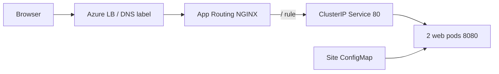

# Short talk track - monitor cues and commands
**Order:** essentials -> C0-C7 walkthrough -> technical evidence -> core wrap -> optional cloud tail.
**Clock:** 55 main / 3 protected recovery / 2 close. Cuts win; one attempt, then dated fallback.
**Context:** PowerShell 7; `C:\demo\session-repo` = public clone/checkpoint; `C:\demo\aks-automatic-demo-env` = pre-staged public consumer.
`!` = whole shell block, same CLI window; variables do not survive turns. Slash actions = TUI; other text = human prompt; no private root/evidence.
No secrets/state, blanket approval, provider/lock upgrades, live plan/apply/import/state removal.
## Essentials | Martin says: artifact • owner • reason • evidence • human stop
```powershell
Set-Location C:\demo\session-repo
git status --short
git --version; copilot --version; squad --version
copilot --agent squad
```
TUI: `/cwd`, `/agent`, `/model` → `claude-sonnet-5`, `/instructions`, `/permissions`.
Small read-only brief, `/agent terraform-reviewer`: `Explain module versus caller ownership and the private API invariant in five bullets. No edits, commands or Azure access.`
Checkpoint: right root, three project profiles; missing profiles = exit/restart, not reinstall Squad 1.0.1.
## C0 | Haflidi 05:30-08:30, CUT 07:45 | install • init • hire • verify
Shell only on a separately qualified clean host; current VM/Haflidi/disk/SYSTEM gates stay. Otherwise disclose fallback.
```powershell
$PSVersionTable.PSVersion; Get-Command git, copilot, squad -ErrorAction SilentlyContinue
$wg = '--exact', '--source', 'winget', '--accept-package-agreements', '--accept-source-agreements', '--silent'
winget install --id Git.Git @wg
winget install --id GitHub.Copilot @wg
winget install --id bradygaster.Squad @wg
$env:Path = [Environment]::GetEnvironmentVariable('Path', 'Machine') + ';' + [Environment]::GetEnvironmentVariable('Path', 'User')
git --version; copilot --version; squad --version
copilot
```
TUI `/login`, `/exit`; then shell:
```powershell
git clone https://github.com/martinopedal/terraform-azapi-aks-automatic.git $HOME\demo\aks-module
Set-Location $HOME\demo\aks-module
squad init
git status --short
copilot --agent squad
```
Prompt: `We maintain a reusable Terraform module for AKS Automatic on azapi that deploys into an existing Azure landing zone. Work is Terraform module code, terraform test contract tests, and consumer documentation. Propose a small team.`
Human confirms roster; TUI `/exit`; shell `squad doctor`. Checkpoint: actual files/diagnostics, not code correctness.
## C1 | Martin drives / Haflidi compares 12:30-15:30, CUT 14:45 | fixed inputs
Return to the prepared PUBLIC session A/B worktrees, not the C0 upstream clone.
TUI `/new`, `/agent` → Squad, `/model`, `/plan`, `/rename C1-A`; repeat `C1-B`.
```text
Plan only: add alternate_network_payload to the existing module contract tests. Use pod 172.21.0.0/16, service 10.241.0.0/16, and DNS 10.241.0.10.
Assert propagation into the requested body while preserving the private API. Don't edit files or deploy. Identify affected files, one writer, and checks.
```
Checkpoint: one consequence; same model/checkpoint; no retry for different prose.
## C2 | Martin 17:30-21:30, CUT 20:30 | plan • revise • code-only approval
Guided worktree TUI `/new`, `/rename guided-clean-run`, `/agent` → Squad, `/instructions`, `/plan`.
```text
@terraform\modules\aks-automatic-corp\main.tf @terraform\modules\aks-automatic-corp\variables.tf @terraform\modules\aks-automatic-corp\tests\contract.tftest.hcl
This is prepared, qualified code. Plan the C1 regression test and its README explanation. Keep all eight inputs, six outputs, and the AzAPI resource intact.
Plan a separately labeled enablePrivateCluster mutation and repair. No implementation, Azure lookup, apply, dependency upgrade, or state operation.
```
Revise: `Put unchanged payload assertions and offline checks before documentation; exclude infrastructure redesign.`
Inspect `/session plan`; human accepts exact scope; leave Plan mode via UI. Not deployment consent.
## C3 | Martin 22:00-26:00, CUT 25:00 | genuine Squad • one writer • handoff
TUI `/agent squad`, `/tasks`, `/agent list`, `/mcp`; prompt: `Squad: assign independent read-only source research and review preparation. One coder owns the test; return actual task handoffs.`
Then `/agent terraform-coder`; paste B1v2:
```text
Work only in terraform\modules\aks-automatic-corp.
Add one run block named alternate_network_payload to tests\contract.tftest.hcl. Reuse the existing AzAPI mock and command = plan. Use pod CIDR 172.21.0.0/16, service CIDR 10.241.0.0/16 and DNS service IP 10.241.0.10. Write four separate assert blocks, one each: the pod CIDR, the service CIDR and the DNS service IP propagate into the requested cluster body, and the API server stays private. Each assert gets its own error_message. Change only tests\contract.tftest.hcl. Don't deploy, don't change providers or the lock file.
```
Checkpoint: real starts/diff/handoffs; manual profile selection alone is not parallel work; B1v2 5/5 is historical.
## C4 | Martin 29:30-33:30, CUT 32:30 | BASE ONLY • skill • source • permission
TUI `/agent squad`, `/skills info test-discipline`, `/mcp`; prompt:
```text
Invoke test-discipline now. Identify which existing contract assertions must remain unchanged during the mutation.
Through Microsoft Learn MCP, read-only search/fetch AKS Automatic private/custom network requirements; cite source/version for private API and hosted-system subnets. No Azure account or provider changes.
```
`/permissions`: narrow read-only request. Checkpoint: actual source URL/version; failed lookup stays failed.
## C5 | Haflidi 33:30-38:30, CUT 37:15 | before • deliberate fail • narrow repair
TUI `/agent terraform-validator`; approve each command. `!` in guided; uncredentialed/network-restricted, filesystem mirror only. Full [C5 log block](demo-runbook.md#c5-seed-fail-repair--3330-3830--5-minutes) retains exits/hashes:
```powershell
$PSNativeCommandUseErrorActionPreference = $false
$env:TF_CLI_CONFIG_FILE = (Resolve-Path '..\offline\terraform.tfrc').Path
$env:CHECKPOINT_DISABLE = '1'; $env:TF_IN_AUTOMATION = '1'
if (Get-ChildItem Env: | Where-Object Name -Match '^(ARM_|AZURE_(?!CORE_)|TF_VAR_|TF_CLI_ARGS)') { throw 'Inherited credentials/overrides are not permitted.' }
terraform -chdir='terraform\modules\aks-automatic-corp' init -backend=false -input=false -lockfile=readonly
if ($LASTEXITCODE) { throw 'Offline initialization failed.' }
terraform -chdir='terraform\modules\aks-automatic-corp' test -no-color
"Exit: $LASTEXITCODE"
```
Before must pass; preserve source hash. `/agent terraform-coder`: `In this disposable worktree only, change body.properties.apiServerAccessProfile.enablePrivateCluster from true to false. Nothing else.`
Rerun same test: require intended `private_automatic_contract` failure, not auth/syntax failure.
`/review`: labeled mutation, read-only. Coder restores only field; `/diff`; validator reruns: exit 0/original hash.
## C6 | Haflidi 42:00-45:00, CUT 44:15 | public reason • resume • cite
`/agent squad`; prompt: `Scribe: record the public-only decision under .squad\decisions\inbox\ for later merge. Private API, caller provider/backend, regression, mutation/repair, exact checks and evidence limits. No private targets or histories.`
TUI `/new`, `/resume guided-clean-run`, `/cwd`, `/context`, `/usage`.
Prompt: `Read the saved decision; cite its file and the constraints for the next change.`
Checkpoint: actual cited reason; hide unrelated sessions. If stalled, show saved public decision.
## C7 | Haflidi 47:00-50:00, CUT 49:15 | offline oracle • independent review
Same isolation as C5; TFLint 0.64.0. `/agent terraform-validator`; `!` in guided, `Check` stops immediately; full logging in [runbook](demo-runbook.md#c7-validate-the-consumer-and-review--4700-5000--3-minutes):
```powershell
$PSNativeCommandUseErrorActionPreference = $false
$env:TF_CLI_CONFIG_FILE = (Resolve-Path '..\offline\terraform.tfrc').Path
$env:CHECKPOINT_DISABLE = '1'; $env:TF_IN_AUTOMATION = '1'
if (Get-ChildItem Env: | Where-Object Name -Match '^(ARM_|AZURE_(?!CORE_)|TF_VAR_|TF_CLI_ARGS)') { throw 'Inherited credentials/overrides are not permitted.' }
function Check($id, $exe, [string[]]$argv) { & $exe @argv; if ($LASTEXITCODE) { throw "$id failed: $LASTEXITCODE" } }
$m = 'terraform\modules\aks-automatic-corp'; $e = "$m\examples\corp-existing"
Check fmt terraform @("-chdir=$m",'fmt','-check','-recursive')
Check init terraform @("-chdir=$m",'init','-backend=false','-input=false','-lockfile=readonly')
Check validate terraform @("-chdir=$m",'validate','-no-color')
Check lint tflint @("--chdir=$m",'--config=.tflint.hcl','--no-color')
Check module terraform @("-chdir=$m",'test','-no-color')
Check example-init terraform @("-chdir=$e",'init','-backend=false','-input=false','-lockfile=readonly')
Check example-validate terraform @("-chdir=$e",'validate','-no-color')
Check example terraform @("-chdir=$e",'test','-var-file','terraform.tfvars.example','-no-color')
Check diff git @('--no-pager','diff','--',$m)
```
`/diff`; `/new`, `/agent terraform-reviewer`. Prompt: `Review this exact diff/revision/files and sanitized validator evidence. Report severity/file/line/consequence; missing evidence is blocked. No edits or commands.`
Return to `/agent squad` + human acceptance. Checkpoint: actual independent review; mocks are not Azure proof.
## Technical evidence / core wrap | Martin + Haflidi, finish by 55:00
50:30-51:00 browser: `https://aks-online-demo.swedencentral.cloudapp.azure.com/` (known certificate warning).
Say: module/caller • typed inputs • Automatic/Standard • private API • pins/root state • PR/checks/review/plan/human gate/OIDC/read-back.
Current app/TLS-bypassed evidence is not full health or fresh 29/29. No live Terraform apply blob.
Ingress keywords: Azure DNS label/LB -> dedicated managed NGINX -> `/` rule -> Service 80 -> two web pods 8080.
Site ConfigMap mounts page/config; namespace policy admits App Routing traffic. HTTP redirects; default self-signed TLS, no trusted cert/AGC/ALB.
Source-only screen cue, pre-staged PUBLIC consumer clone; no login/kubeconfig/secret queries:
```powershell
Set-Location C:\demo\aks-automatic-demo-env
Get-Content .\manifests\online\ingress-controller.yaml, .\manifests\online\ingress.yaml, .\manifests\online\service.yaml
```
Checkpoint: exact public manifests, not runtime health. [Source trace and limits](talk-track.md#s20-consumer--5000-5300--an-online-consumer).

53:00-55:00 limits/core wrap first; protect 55:00-58:00 recovery and 58:00-60:00 close. Questions only if time allows.
## Optional final extras - only if time and live gates permit
**DEAD LAST:** only genuine early finish after ALL core work/wrap; never compress core; protect 55:00-58:00 recovery / 58:00-60:00 close.
**1. Squad on ACA Apps/Jobs - Haflidi; currently HELD, read-only or SKIP.** Original service untouched.
Accepted source ≠ live E2E; publisher network/TLS/DNS/Docker failure, image/auth/actual bot PR gates remain.
Only authorized hosted-target clone, operator-resolved aliases, private screen; read-only existing-chain probe:
```powershell
Set-Location C:\demo\hosted-target
$targetRepo = '<approved-private-target>'; $botApp = '<approved-bot-app>'
gh auth status
gh run list --repo $targetRepo --workflow squad-queue.yml --limit 3
gh pr list --repo $targetRepo --author $botApp --state open
```
No new issue/label/unsafe Job/auth mint while held. Require same issue→queue→actual Job→bot PR; missing proof = SKIP.
**2. ACA Sandboxes - Martin; own human GO or SKIP.** Host Squad/controller, native MicroVM, not Apps/Jobs or guest OAuth.
Accepted 26.768s/85 rehashes ≠ human rehearsal. Read-only exact-target gate, only in separately approved host session:
```powershell
Set-Location C:\demo\session-repo
aca --version
$nativeTarget = @('--subscription', '<approved-online-subscription>', '--resource-group', '<approved-native-resource-group>', '--sandbox-group', '<approved-native-sandbox-group>', '--region', '<approved-native-region>')
aca auth status @nativeTarget -o json
aca doctor @nativeTarget
```
Tokens/green doctor ≠ target access; compare printed target + independent exact-ID read-back. Mismatch/hold = SKIP.
Only after real GO: host `copilot --agent squad`; [bounded fixture prompt](prompt-pack.md#native-host-squad-isolated-work).
Checkpoint: guest checks/JSON/SHA/numeric exits/causal denial + validator/reviewer handoff; one attempt/cut before 55:00.
No create/upload/install/egress change, host-auth copy or guest agents. Separately approved exact-ID cleanup off-stage.
