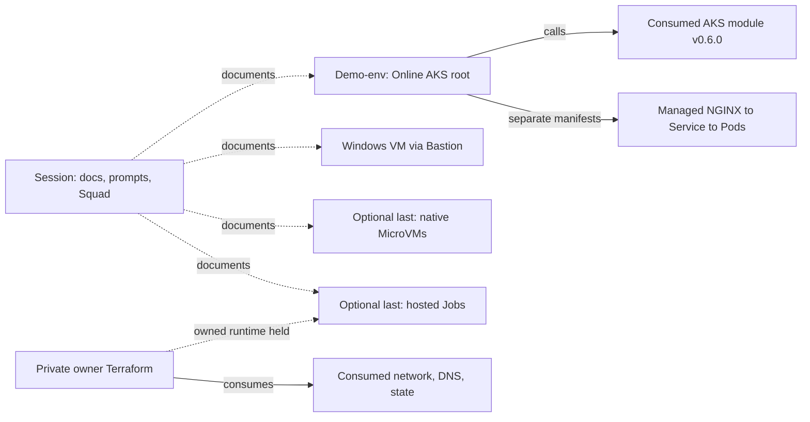

# Demo repository and stack overview

This is the **documentation, prompts, Squad coordination and presentation
repository**. It explains and orchestrates the learning flow; it does not own
every Azure resource shown in the session. Keep the
[existing source/deployment table](../README.md#source-and-deployment-table)
and [repository map](repositories.md): this overview adds the resource and
connection view, not a replacement inventory.

Read essentials first, then the walkthrough, then the technical AKS/module/
ingress detail. **ACA Apps/Jobs and native ACA Sandboxes are separate, optional,
last, only-if-time lanes.** This page is a factual architecture reference, not a
new execution cue list or a change to the speaker/run-plan artifacts.

## Capabilities and ownership

| Capability | Where its source belongs | What this repository contributes |
| --- | --- | --- |
| Copilot CLI + Squad essentials and walkthrough | This session repository | Prompts, native profiles, skills, coordination, teaching material and review/evidence boundaries. |
| Reusable AKS contract | Upstream Automatic module at the consumer's `v0.6.0` pin | [Explains consumption](module-consumption.md); does not edit or release the dependency. |
| Existing Online AKS and website | Demo-env `deployments\online` + `manifests\online` | Technical explanation, not a second deployment root. |
| Presenter Windows VM/Bastion | Demo-env `deployments\demo-vm` | Setup teaching material; current disk/power preservation remains a separate operator gate. |
| Hosted Apps/Jobs, optional last | Original Haflidi implementation / owned MIT fork; private resource-owner Terraform | Explains distinct source, target, publisher and runtime layers. No standalone fork Bicep deployment or changes to the original working service. |
| Native SandboxGroup MicroVMs, optional last | Demo-env `deployments\aca-sandboxes-online`, separate Bicep lane | Describes accepted bounded host-driven checks, not guest OAuth or human rehearsal completion. Not inside AKS or the hosted Jobs service. |
| Shared network, DNS, state and runner capabilities | Existing private platform owner roots | Documents consumed dependencies; no new networking, IAM, state ownership or resource-creation authority. |

Arrows describe source relationships/capabilities, not fresh deployment or
end-to-end GO. The app data plane is explained separately below. Static website,
VM, hosted worker and native sandbox are not interconnected merely because
they appear in the same diagram.

## Resource-group and subscription matrix

**Publication scope:** the user explicitly approved these nonsecret demo-stack
RG names and the four subscription GUIDs on October 13, 2026. This is a narrow
exception to the generic private-identifier guidance, only for this matrix and
its directly related explanation. Credentials, principal/App identifiers,
secret values, raw plans/state, costs, personal data and unrelated customer
estate remain excluded. A row is not authority to create or modify anything.

The subscription column below joins exactly to this alias table; aliases are
placement labels, not authentication contexts. No account switch was performed.

| Alias | Exact approved subscription ID |
| --- | --- |
| Online | `714ac8e0-8874-428d-a4f3-79bd3765bfed` |
| Corp | `9d5a5ae2-a09a-4691-9d2b-52a700bb07a7` |
| Management | `7ebcc54a-6228-410d-acec-9efffa9ed693` |
| Connectivity | `2be052bf-31b0-4693-8081-bf6556421934` |

**Evidence key:** `C` is the read-only demo-env revision
`dbb7e4c6f19a6c8fcd31ca61085e449d1a9fd87c`; `P` is the private platform owner
`alz-avm-tf-demo/alz-prod` main revision
`be2081c8f2bd99683ffc14022f79d31f50f66f2d`, confirmed by GitHub metadata.
Private source bodies/inputs are not reproduced. Source inspection and the
bounded ARM GET/list observations below were made **2026-10-13, 07:25-07:36 UTC**.
`M1`-`M6` identify read-only metadata families in the evidence notes. "Present"
means observed resource metadata, not app execution or state-custody proof.

| Component / purpose | Subscription | Exact RG | Region: RG / relevant resource | Owner root or consumed source | Deployed, consumed or proposed; readiness | Evidence |
| --- | --- | --- | --- | --- | --- | --- |
| Existing `aks-online-demo`, root network/NAT/identity/namespace; Online state account | Online | `rg-aks-online-demo` | Sweden Central | C: `deployments\online`; backend storage is a prerequisite, not a resource declared by that root | Present; AKS Automatic/Standard, Succeeded/Running. Website earlier passed with TLS bypass; current trusted TLS fails. No redeploy/repair approval. | C: `main.tf`, `network.tf`, `identity.tf`, `namespace.tf`, `terraform.tf`; `deploy-online.yml`; M1 |
| AKS service-managed nodes, ingress frontend and add-on identity | Online | `MC_rg-aks-online-demo_aks-online-demo_swedencentral` | Sweden Central | AKS service-managed RG referenced by cluster metadata; not a new session Terraform root | Consumed/present. DNS-labelled Standard public IP observed; do not import service-managed resources. | C: `manifests\online\ingress-controller.yaml`; M1 |
| Windows presenter VM, private NIC, Bastion and NAT | Online | `rg-demo-vm-online` | Sweden Central | C: `deployments\demo-vm` | Present; VM D4s_v5, deallocated. Current attached OS disk differs from earlier receipt. Preserve current and earlier disks; source proposal is not installed bootstrap/runtime proof. | C: `main.tf`, `network.tf`; M2 |
| Native SandboxGroup, separate host-driven MicroVM demo | Online | `rg-aca-sandboxes-online-swc-001` | Sweden Central | C: `deployments\aca-sandboxes-online`, separate protected qualification lane | Present/Succeeded. October 12 five bindings/base probe and accepted 26.768-second host contract; test cleanup empty. Guest agents/OAuth and human stage rehearsal unproved. | C: `main.bicep`, `sandbox.bicep`, `aca-sandboxes-online.yml`; M3; accepted host evidence |
| Existing Online deployment runner, its environment/VNet and state private endpoint | Online | `rg-runners-shared-personal` | Sweden Central | C: `scripts\start-online-runner.ps1` consumes Job; P: `infra\shared\personal` declares RG/registry. Exact Job/VNet/PE Terraform state owner not verified here | Present/consumed: `caj-online-demo-runner` and private endpoint to the Online state account. Do not assume the helper or session owns their complete resource bodies. | C: helper and `deploy-online.yml`; P: shared `main.tf`; M4 |
| Hosted queue, ACR, Key Vault, identity/logs, ACA environment and Jobs | Corp | `rg-squad-aca-corp-swc` | RG/supporting resources Sweden Central; environment/Jobs **Norway East** | P: `infra\squad-on-aca-corp`; original hosted service unchanged; owned source/target/publisher separate | Existing resources present. Worker Event / target runner Manual. Owned scheduled-poller/runtime changes remain proposed/held, not deployed/E2E. ACR Premium, public access Disabled, admin false. | P: `main.tf`, `owned-runtime.tf`, `versions.tf`; M5 |
| Hosted Sweden Central network and private endpoints | Corp | `rg-squad-aca-corp-network-swc` | Sweden Central | P: `infra\squad-on-aca-corp`; consumes Connectivity IPAM | Present/consumed VNet and queue/ACR/vault private endpoints. No claim Management publisher can reach them. | P: `main.tf`; M5 |
| Actual hosted Norway East environment network | Corp | `rg-squad-aca-corp-aca-ne` | Norway East | P: `infra\squad-on-aca-corp`; central DNS links in `infra\avnm-platform` | Present/consumed: environment infrastructure subnet points here. Norway East queue/vault/ACR private endpoints observed. Cross-region workload-RG naming does not relocate the environment. | P: `main.tf`; `squad-aca-connectivity.tf`; M5 |
| A1 private publisher/runner dependency | Management | `rg-alz-prod-agents-swedencentral-001` | Sweden Central | P: `infra\pool-a1`; application publisher source is a separate private repo | Present/consumed `caj-a1-runner`, `cae-alz-mgmt-swedencentral`, registry. Publisher source accepted; actual Docker/DNS/TLS qualification failed, no qualified image or genuine bot PR. Not a newly authorized runner. | P: `variables.tf`, `data.tf`, `aca-env.tf`, `imports.tf`; M6 |
| A1 runner VNet/subnet dependency | Management | `rg-alz-prod-network-swedencentral-001` | Sweden Central | P: `infra\pool-a1` reads existing VNet/subnets; platform network ownership retained | Present/consumed `vnet-alz-prod-swedencentral-001`; zero classic peerings observed. This does not prove AVNM routing/private registry reachability or authorize new peering. | P: `variables.tf`, `data.tf`; M6 |
| A1 environment monitoring dependency | Management | `rg-management-swedencentral` | Sweden Central | P: `infra\pool-a1\variables.tf` references existing platform Log Analytics workspace | RG present; workspace ID is a declared consumed dependency. Logging ingestion and exact workspace state ownership not qualified by this inventory. | P: `variables.tf`; M6 |
| Canonical hub/AVNM/IPAM connectivity dependency | Connectivity | `rg-hub-swedencentral` | Sweden Central | P: `infra\avnm-platform`; hosted root consumes two IPAM pools | AVNM and both hosted IPAM pools present/Succeeded. Source references existing hub; this is not proof that A1-to-Corp connectivity/DNS works. | P: `locals.tf`, `ipam-squad-on-aca.tf`, hosted `main.tf`; M6 |
| Central private DNS consumed by hosted network | Connectivity | `rg-hub-dns-swedencentral` | RG Sweden Central; DNS service global | P: `infra\avnm-platform\squad-aca-connectivity.tf`; platform DNS ownership retained | RG present; hosted Norway East ACR-zone VNet link Succeeded. Queue/vault/ACR links declared in source; no end-to-end resolver/TLS qualification inferred. | P: `squad-aca-connectivity.tf`; M6 |
| Private backend dependency for hosted owner and AVNM | Connectivity | `rg-tfstate-net-swedencentral` | Sweden Central | P: hosted partial backend/configuration and `infra\avnm-platform\versions.tf` | `stalznetstateswc01` present, public access Disabled. Backend declaration is metadata, not verified current state custody or permission to download state. | P: hosted `versions.tf`, `backend.tfbackend`; AVNM `versions.tf`; M6 |

### Evidence notes and exclusions

- **M1 (07:25-07:29 UTC):** exact Online cluster GET (`Microsoft.ContainerService`, API
  `2025-07-01`) confirmed SKU/power, public CIDR-restricted API, Entra RBAC,
  local accounts disabled and `ingressProfile.webAppRouting.enabled=true`.
  Exact RG inventory, node-RG GET, DNS-labelled public-IP metadata, DNS A lookup
  and normal certificate-validating HTTPS request were read-only.
- **M2 (07:26-07:27 UTC):** exact VM/RG metadata confirmed size, power and current OS-disk name.
  No disk swap, resize, start, stop, CSE/install or managed Run Command occurred.
- **M3 (07:28-07:30 UTC):** Online sandbox resource-type inventory located the one demo group;
  exact group GET with API `2026-07-01` confirmed Succeeded. An initial GET with
  unsupported `2026-05-01-preview` failed; the supported-version GET succeeded.
  No credentials, sandbox execution, auth changes or new config were requested.
- **M4 (07:30-07:31 UTC):** exact runner RG resource metadata and exact state private-endpoint GET
  confirmed its target is the Online state account. Storage-account GET confirmed
  public access Disabled/shared-key access false. No blob/container/state read.
- **M5 (07:26-07:31 UTC):** exact three Corp RG inventories and environment/worker/target Job GETs
  supplied region/subnet/trigger metadata only. ACR GET checked SKU/public/admin
  flags, not keys, tokens, image publication or secret values.
- **M6 (07:28-07:31 UTC; backend declaration 07:36 UTC):** exact named Management/Connectivity RGs/resources were read. A1 VNet
  classic peering names yielded an empty list; AVNM, the two hosted IPAM pools and
  hosted Norway East ACR DNS link were queried individually. Backend account GET
  was metadata only. No whole-tenant/VNet estate enumeration occurred.

The Azure MCP group lookup failed; the already authenticated operator Azure CLI
provided the bounded read-only fallback, without switching account or exporting
tokens. Successful ARM metadata access is not Kubernetes access. No
`az aks get-credentials`, kubeconfig creation, admin token or Secret GET was used.

The October 12 host receipt/independent acceptance establishes bounded native
engineering, not guest Copilot OAuth or human rehearsal. Owned hosted source
preparation merged at the P revision; its main delivery run failed and source
CI does not release current custody, baseline, image, authentication, policy,
quota, private-plan transport or exact-plan/human gates. Original hosted-service
status and the owned proposal remain distinct. A cutoff is not schedule
retirement, worker restoration or cost/cleanup proof.

Backend metadata: Online uses the approved Online state account/container with
workflow key `aks-automatic-online.tfstate`; demo-VM uses `demo-vm.tfstate`.
Hosted owner declares the Connectivity backend/container `squad-on-aca-corp`; AVNM
declares container `avnm-platform`, key `terraform.tfstate`. These are independent
root state scopes, not one session-owned state. No state or private plans were
read. Resources with no verified owner are explicitly not assigned an invented
owner. Held Corp native qualification and unrelated tenant/customer resources
are excluded; this matrix is exhaustive only for the bounded documented demo
capabilities/dependencies, not the entire landing zone.

## Actual AKS demo ingress

Source: C's `deployments\online\main.tf` and `namespace.tf`, plus
[`manifests\online`](https://github.com/martinopedal/aks-automatic-demo-env/tree/dbb7e4c6f19a6c8fcd31ca61085e449d1a9fd87c/manifests/online)
and `deploy-online.yml`. The October 13 ARM/DNS observations confirm the
Application Routing add-on and Azure DNS-labelled frontend, **not a fresh
in-cluster manifest read-back**.

**Configured data-plane path:**
browser -> `https://aks-online-demo.swedencentral.cloudapp.azure.com/` ->
controller's public Standard Load Balancer frontend ->
managed Application Routing NGINX controller -> `online-demo` Ingress
(class `online-demo`, `/` Prefix) -> `online-demo` ClusterIP Service port 80 ->
`app=online-demo` Pods, named HTTP port / container 8080.

- `ingress-controller.yaml` defines cluster-scoped
  `approuting.kubernetes.azure.com/v1alpha1` `NginxIngressController`
  `online-demo`, class/prefix `online-demo`, and Azure DNS label `aks-online-demo`.
  It is not an assumed separately installed ingress-nginx, AGC/ALB, Gateway API
  or classic Application Gateway. AGC is explicitly disabled in the module call.
- `ingress.yaml` has no host restriction, forces HTTP-to-HTTPS redirect and
  contains `tls: - {}` without `secretName`. The documented default NGINX
  self-signed certificate is not trusted production TLS; no Key Vault
  certificate integration is configured in this consumer. The normal October
  13 HTTPS probe failed certificate trust (curl exit 60); prior HTTP 200 with
  explicit bypass is only application reachability evidence.
- `deployment.yaml` requests two replicas of digest-pinned unprivileged NGINX
  as UID/GID 10001. Kustomize generates a content-hashed site ConfigMap with
  `index.html`, `default.conf` and the two presenter images. These are static
  media/page assets served by the same Pod backend, not a second media service.
  `default.conf` serves direct-pod `/healthz` as `200 ok` and substitutes the
  Pod hostname/time in the page. External `/healthz` is not the acceptance
  contract; it must not be counted as an independent ingress-health failure.
- Root `namespace.tf` owns ARM managed namespace `online-demo`, restricted Pod
  Security labels, quota and default-deny ingress/egress. `networkpolicy.yaml`
  allows controller traffic from `app-routing-system` to app Pods on TCP 8080.
  The website does not call the hosted queue, VM or sandbox.

**Separate control plane:** the cluster's API FQDN (`cluster_fqdn` output) is not
the app URL. The public API requires its approved CIDR allow-list and Entra
authorization; local accounts are disabled. The existing private runner uses
that path for deployment. Its static NAT egress, node/system outbound NAT,
API-server subnet and ingress frontend are different connections.

**Readiness before a demo claim:** verify DNS matches the dedicated controller's
own labelled LoadBalancer Service (not potentially stale Ingress status), actual
controller/class/rule, Service endpoints and two ready backend Pods, direct-Pod
health, matching site/media, redirect and the stated TLS limitation. Source and
ARM metadata do not prove all of those live checks. The existing evidence remains
26 PASS / 2 BLOCKED / 1 report-only with explicit TLS bypass; full cluster
health and current Kubernetes access are not established by this documentation.
Do not redeploy a working cluster, widen access or retrieve credentials to make
the diagram look complete.

For exact module/provider/output wiring, continue to
[module consumption](module-consumption.md). Use the existing
[evidence boundary](../QUALITY.md), [sandbox progress](sandboxing.md) and
[repository map](repositories.md) for the separately gated runtime lanes.
